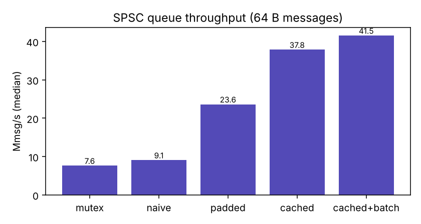
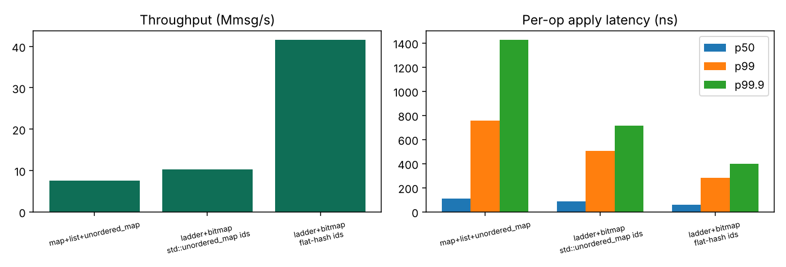

# lowlat-md-pipeline

A small market-data pipeline in C++20: a parser for ITCH-5.0-style binary feeds, a lock-free single-producer/single-consumer queue (four variants), and an order-book builder that does no heap allocation after start-up. Everything is benchmarked against simpler alternatives with a TSC-based harness.


The questions it tries to answer: where does the time go (parse, queue or book), which design choices matter and by how much, and can the hot path be shown to never touch the heap.

## Components

| file | what |
|---|---|
| `include/ll/itch.hpp` | message layouts, zero-copy parser, encoder. 64-byte decoded `Msg` (one cache line) |
| `include/ll/spsc.hpp` | `MutexQueue`, `NaiveSpsc`, `PaddedSpsc`, `CachedSpsc` (plus a batch pop) |
| `include/ll/book_ladder.hpp` | order-book builder: 32-byte orders linked by 32-bit pool indices, tick-indexed price levels, 2-level bitmap for best bid/ask |
| `include/ll/id_map.hpp` | order id to slot: open addressing with backward-shift deletion, and a `std::unordered_map` wrapper for comparison |
| `include/ll/book_map.hpp` | baseline and test oracle: `std::map` + `std::list` + `std::unordered_map` |
| `include/ll/histogram.hpp`, `common.hpp` | log-linear histogram (about 6% bucket error), serialized `rdtsc`, TSC calibration, timer-overhead subtraction |
| `src/replay.cpp` | the full pipeline, paced or unlimited, with optional pinning and hugepages |
| `src/bench_book.cpp`, `src/bench_spsc.cpp` | single-thread book benchmark, queue throughput and ping-pong latency |
| `src/gen.cpp`, `include/ll/flowgen.hpp` | deterministic synthetic order flow (add 44%, delete 30%, execute 10%, partial cancel 8%, replace 8%) |

## Results

Measured with `scripts/run_all.sh` (5 runs each, medians), 4,000,000 synthetic messages, 4 symbols.

```
cpu:      Intel Core Ultra 7 155H (laptop)
kernel:   Linux 6.6.87.2-microsoft-standard-WSL2
compiler: g++ 13.3.0
```

This was run under WSL2, not on bare-metal Linux. See Limitations before reading the tail latencies.

### Queue variants (64-byte messages, producer and consumer on separate threads)

| queue | Mmsg/s | one-way p50 ns | p99 ns | p99.9 ns |
|---|---|---|---|---|
| mutex | 7.61 | 378 | 2857 | 6387 |
| naive (seq_cst, indices share a cache line) | 9.05 | 199 | 336 | 1513 |
| padded (separate cache lines, acquire/release) | 23.61 | 168 | 241 | 567 |
| cached (padded + cached opposite index) | 37.84 | 136 | 241 | 378 |
| cached, consumer pops in batches of 32 | 41.53 | | | |

Moving the two indices onto separate cache lines and relaxing seq_cst to acquire/release (I changed both at once, so I cannot split the two effects) is the biggest step: 9.05 to 23.61, 2.6x. Caching the other side's index adds another 1.6x, and batch popping about 10% more.



### Order book (single thread)

| book | Mmsg/s | p50 ns | p99 ns | p99.9 ns | heap allocations per message |
|---|---|---|---|---|---|
| `std::map` + `std::list` + `std::unordered_map` | 7.59 | 110 | 756 | 1428 | 0.986 |
| ladder + bitmap, `std::unordered_map` ids | 10.27 | 89 | 504 | 714 | 0.493 |
| ladder + bitmap, flat-hash ids | 41.64 | 60 | 283 | 399 | 0 |

The table above is from the `run_all.sh` session, where the flat-hash ladder reached 5.5x the baseline. Repeating the benchmark in later sessions gave much lower absolute numbers for the same code, so I would not quote the 41.6 figure on its own. All values are Mmsg/s, single thread:

| session | max_orders | pinned | baseline | ladder, std hash | ladder, flat hash | flat / baseline |
|---|---|---|---|---|---|---|
| `run_all.sh` | 262,144 | yes | 7.59 | 10.27 | 41.64 | 5.5x |
| repeat 1 | 1,048,576 | yes | 5.15 | 9.56 | 19.62 | 3.8x |
| repeat 1 | 262,144 | yes | 4.43 | 10.10 | 19.04 | 4.3x |
| repeat 2 | 1,048,576 | no | 5.54 | 10.58 | 20.50 | 3.7x |
| repeat 2 | 262,144 | no | 5.25 | 10.85 | 24.47 | 4.7x |

The flat-hash ladder was 3.7x to 5.5x the baseline in all five measurements and had the lowest p99 and p99.9 every time (the p50 had no consistent winner). The same flat-hash code ran anywhere between 19 and 42 Mmsg/s depending on the session, so absolute numbers on this machine are not stable. How the gain splits between the two changes also varied: the ladder with pool-allocated orders was 1.35x to 2.3x over the baseline, and the flat hash on top of it another 1.9x to 4.0x. Both steps helped every time. The allocation column comes from the replaced `operator new` counter; `test_noalloc` asserts zero allocations over 1,000,000 messages for the flat-hash book and about one per message for the baseline.



### Table size

Flat-hash ladder with tables sized for 1,048,576 vs 262,144 orders (live orders peak around 200,000), 5 runs each:

| max_orders | pinned | Mmsg/s | p50 ns | p99 ns | p99.9 ns |
|---|---|---|---|---|---|
| 1,048,576 | no | 20.50 | 195 | 434 | 652 |
| 262,144 | no | 24.47 | 92 | 391 | 587 |
| 1,048,576 | yes | 19.62 | 240 | 589 | 1003 |
| 262,144 | yes | 19.04 | 141 | 609 | 993 |

The median latency was about 40 to 50% lower with the smaller tables in both pairs, but throughput went up 19% unpinned and down 3% pinned, and the tails did not move consistently. Given the session-to-session variation above, I could not show a reliable effect of table size. The raw output of the unpinned pair is in `results/table_size_unpinned_*.txt`; the pinned figures were copied from the terminal and the raw output was not saved.

### Full pipeline

Maximum throughput (no per-message timestamps):

| queue | book | Mmsg/s |
|---|---|---|
| mutex | ladder | 2.59 |
| naive | ladder | 5.12 |
| padded | ladder | 11.76 |
| cached | ladder | 12.99 |
| cached | `std::map` baseline | 3.93 |
| cached | ladder, `std::unordered_map` ids | 6.83 |

The pipeline (13.0 Mmsg/s) is well below the book alone (41.6) and the queue alone (37.8); I have not profiled where the rest goes (parse, the cross-core handoff, or both).

Paced at 1,000,000 messages/s (so end-to-end latency means something):

| config | apply p50 / p99 / p99.9 ns | end-to-end p50 ns | end-to-end p99 ms |
|---|---|---|---|
| pinned, `std::map` baseline | 273 / 1219 / 3364 | 588 | 9.3 |
| pinned, ladder | 199 / 565 / 838 | 482 | 7.9 |
| unpinned, ladder | 199 / 567 / 840 | 483 | 4.0 |
| pinned + hugepages, ladder | 189 / 546 / 756 | 462 | 2.9 |

The ladder book cuts the apply time at every percentile (p99.9: 3364 to 838 ns). Pinning and hugepages changed the apply times by only 5 to 10% in this environment.

The end-to-end p99 of several milliseconds is not caused by the book: the apply p99.9 is under a microsecond. It is also the same order of magnitude with and without pinning, and the pinned run was not the best one. That is consistent with the producer or consumer thread being descheduled for milliseconds by the host (the queue then drains a backlog, and every message in it looks slow), but I have not confirmed it with tracing. Treat the end-to-end tail numbers as an upper bound for this environment, not as a property of the code.

Every run recorded in `results/replay_*.csv` (55 runs, all queue and book variants) ends with the same final-state checksum on the same input, which is how I check that the faster variants compute the same book.

## Design decisions

| decision | alternative | measured by |
|---|---|---|
| flat open-addressing id map | `std::unordered_map` | `bench_book` three-way comparison (above) |
| tick-indexed ladder + bitmap | `std::map` of levels | same |
| separate cache lines for head and tail | shared line, seq_cst | `bench_spsc` |
| cached opposite index | reading the other side's index every time | `bench_spsc` |
| paced replay for latency | flat-out replay | `replay --rate` vs unlimited |
| table sizes matched to the working set | oversized tables | `bench_book --max-orders`: no reliable effect measured (see Table size) |

## Method

- Timestamps are `lfence; rdtsc; lfence`, calibrated against `steady_clock`; the cost of one back-to-back timer pair is measured and subtracted from per-operation latencies.
- Throughput and latency are measured in separate passes, because timestamping every operation serializes the pipeline and removes overlap between cache misses.
- Flat-out replay measures backlog rather than latency (the producer outruns the consumer), so end-to-end latency is only reported for paced runs.
- The input file is `mmap`ed and pre-faulted; all book memory is touched at construction; the measured loop does no I/O and no allocation.
- Differential test: three seeds, 600k operations each, including invalid operations, comparing return values and top-5 level snapshots (with FIFO order) across the three books. ASAN and UBSAN run on all tests, TSAN on all queue variants.
- Heap allocations are counted by replacing global `operator new`; direct `malloc` calls would not be counted (the hot path has none).

## Build and run

Linux (or WSL), g++ 10 or newer.

```
make test
make asan
make tsan
./build/gen results/sample.itch 4000000 1 4
./build/replay --file results/sample.itch --queue cached --book ladder --rate 1000000 --pin 2,3
PROD=2 CONS=3 ./scripts/run_all.sh
```

`run_all.sh` writes `results/*.csv`, `results/summary.md` and the figures in `docs/`. A `CMakeLists.txt` is included; the Makefile is the tested build.

## Limitations

- Measured under WSL2 on a laptop with a hybrid-core CPU: the host scheduler can pause the virtual CPUs, there is no control over the frequency governor, and I did not check which core types the pinned threads landed on. Absolute numbers and especially the tails are not what a tuned bare-metal host would show. The comparisons between variants were run back to back under the same conditions.
- Results vary a lot between sessions on this machine (the same book ran at 19 to 42 Mmsg/s). The ordering of the variants was the same every time, but the queue and pipeline tables come from one session and have not been repeated.
- The workload is synthetic. The message mix is plausible but it is not a market model, and the synthetic book is not matched or uncrossed. The parser follows my reading of the ITCH 5.0 layouts and has only been run on this generator's output, not on a real Nasdaq file.
- The ladder covers a 65,536-tick window; prices outside it, or off the tick grid, are rejected and counted.
- This is a book builder (it applies exchange messages), not a matching engine.
- User-space file replay only: no kernel bypass, no NIC timestamps, one book thread.
- Timing uses x86 TSC; other architectures fall back to `steady_clock`.

## Notes

Developed with assistance from Claude (Anthropic).

